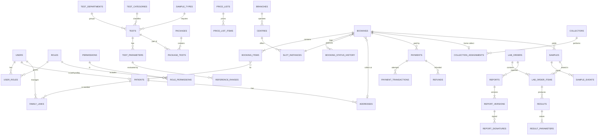
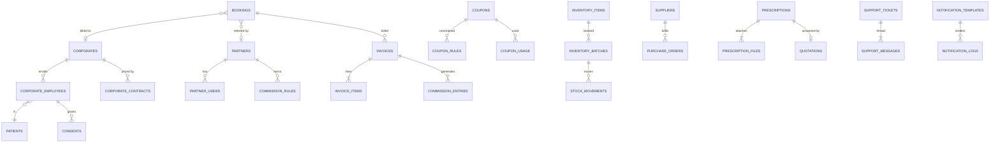

# Database Design

PostgreSQL 16. One schema per module (see `architecture.md` §3). Conventions:

- PK `id uuid` (UUIDv7, generated app-side). Human codes are unique `text` from sequences.
- Every table has `created_at timestamptz not null default now()` and `updated_at`. Mutable config tables also have `version int` (optimistic locking) and `is_active`.
- Money: `bigint` poisha with `CHECK (x >= 0)`. Currency is implicitly BDT.
- Soft delete (`deleted_at`) **only** for config/master data. Clinical and financial rows are never deleted.
- Enums are PG `text` + `CHECK` constraints generated from Python enums (easier to migrate than native PG enums).
- Migrations: Alembic only, one revision chain, reviewed in PR. Production schema changes use expand → migrate → contract.

## 1. ERD — core clinical and commerce flow

## 2. ERD — business modules

## 3. Table notes (by schema)

### auth
| Table | Key columns / constraints | Notes |
|---|---|---|
| `users` | `phone text unique null`, `email citext unique null`, `password_hash null`, `status`, `is_staff`, `last_login_at`; `CHECK (phone is not null or email is not null)`; phone `CHECK ~ '^\+8801[3-9]\d{8}$'` | Identity only. No clinical data. |
| `roles`, `permissions`, `role_permissions` | `code unique` | Seeded; permissions are code-defined, role mapping is DB-editable |
| `user_roles` | `(user_id, role_id, scope_type, scope_id)` unique; `scope_type in (GLOBAL, BRANCH, LAB, CORPORATE, PARTNER)` | Scoped RBAC |
| `sessions` | `user_id`, `device`, `ip`, `ua`, `last_seen_at`, `revoked_at` | Device management |
| `refresh_tokens` | `token_hash unique`, `session_id`, `family_id`, `expires_at`, `rotated_at`, `revoked_at` | Rotation and reuse detection |

### patient
| Table | Notes |
|---|---|
| `patients` | `patient_code unique` (`PT-2026-000001`), `full_name`, `full_name_bn null`, `dob date`, `sex CHECK in (M,F,O)`, `phone null`, `blood_group null`, `owner_user_id null` (the user whose own profile this is). **Every clinical row points to a patient, never to a user.** |
| `family_links` | `(user_id, patient_id)` unique, `relationship CHECK in (SELF, FATHER, MOTHER, SPOUSE, CHILD, SIBLING, OTHER)`. One patient can be linked to several users (e.g. both children managing a parent). |
| `addresses` | `patient_id` or `user_id`, `division_id`, `district_id`, `upazila_id`, `area_id`, `house`, `road`, `block`, `landmark`, `geo point null`, `label`. |
| `geo_divisions`, `geo_districts`, `geo_upazilas`, `geo_areas` | BD location master with `name_en`, `name_bn`. Areas map to `service_zones`. |
| `consents` | `patient_id`, `grantee_type/id` (corporate, doctor), `scope` (RESULTS, ATTENDANCE), `granted_at`, `revoked_at`, `evidence`. |

### catalog
| Table | Notes |
|---|---|
| `test_departments` | Hematology, Biochemistry, … |
| `test_categories` | Hierarchical (`parent_id`) |
| `sample_types` | `code` (EDTA_WB, SERUM, URINE…), container, colour, default volume |
| `tests` | `code unique`, `slug unique`, names en/bn, descriptions, department, category, `sample_type_id`, `sample_volume`, `preparation_id`, `tat_hours`, `home_collection bool`, `centre_collection bool`, `is_featured`, SEO fields, `search_vector tsvector` (generated) + GIN index, `name gin_trgm_ops` index |
| `test_preparations` | Reusable instructions en/bn (e.g. "10–12 h fasting") |
| `test_parameters` | `test_id`, `code`, `name`, `unit`, `result_type CHECK in (NUMERIC, TEXT, OPTION, CALCULATED)`, `decimals`, `formula null`, `display_order`, `loinc null` |
| `reference_ranges` | `parameter_id`, `sex null`, `age_min_days`, `age_max_days`, `sample_type_id null`, `lab_id null`, `method null`, `low`, `high`, `critical_low`, `critical_high`, `text_normal null`, `effective_from/to`. Most-specific match wins (lab > method > sample > sex > age). An exclusion constraint prevents overlapping ranges at the same specificity. |
| `packages` / `package_tests` | Targeting: `sex null`, `age_min/max null`; M:N `package_concerns` |
| `health_concerns` | Patient-facing taxonomy (en/bn, icon, slug); M:N to tests/packages; `search_synonyms` table (term → concern/test) |
| `price_lists` / `price_list_items` | `branch_id null` (null = default), `item_type (TEST/PACKAGE)`, `item_id`, `mrp`, `price`, `effective_from/to`. **All prices come from here.** |

### centre / scheduling
| Table | Notes |
|---|---|
| `branches`, `labs`, `centres` | Centre: `type (BRANCH_CENTRE, COLLECTION_POINT, PARTNER)`, address, geo, phone, `lab_id` (processing lab) |
| `centre_services`, `centre_operating_hours` (weekday, open, close), `holidays` (branch-scoped date) | |
| `service_zones` | Areas served for home collection, with `collection_fee`, `free_above` |
| `slot_templates` | `centre_id` or `zone_id`, weekday, start, end, capacity, `mode (HOME/CENTRE)` |
| `slot_instances` | Materialised daily from templates (job, 14 days ahead): `(owner, date, start)` unique, `capacity`, `booked`, `held`, `CHECK (booked + held <= capacity)`. **Locked with `FOR UPDATE`** when booking. |
| `slot_holds` | `slot_id`, `booking_id`, `expires_at` (released by job) |

### booking / coupon
| Table | Notes |
|---|---|
| `bookings` | `booking_code unique`, `user_id` (booker), `mode`, `centre_id`, `address_id null`, `slot_id`, `status`, `subtotal`, `discount`, `collection_fee`, `total`, `coupon_id null`, `partner_id null`, `corporate_id null`, `source (WEB, CONSOLE, PARTNER, CORPORATE)`, `idempotency_key unique null`, `version`. Indexes: `(user_id, created_at desc)`, `(status)` partial where active, `(slot_id)`, `(centre_id, created_at)` |
| `booking_items` | `booking_id`, `patient_id`, `item_type`, `item_id`, `name_snapshot`, `price_snapshot`, `mrp_snapshot`, `status`. **Snapshots** keep bookings stable when catalog prices change. |
| `booking_status_history` | `booking_id`, `from`, `to`, `actor_user_id`, `reason`, `at`. Append-only |
| `coupons` | `code unique (citext)`, `type (PERCENT, FIXED)`, `value`, `max_discount`, `min_amount`, `starts_at`, `ends_at`, `usage_limit`, `per_user_limit`, `first_booking_only` |
| `coupon_rules` | `coupon_id`, `rule_type (TEST, PACKAGE, CENTRE, CORPORATE, USER, CATEGORY)`, `target_id` |
| `coupon_usage` | `(coupon_id, booking_id)` unique, `user_id`, `amount` |

### payment / billing
| Table | Notes |
|---|---|
| `payments` | `booking_id` or `invoice_id`, `method`, `provider`, `amount`, `status (INITIATED, PENDING, SUCCEEDED, FAILED, CANCELLED, REFUNDED, PARTIALLY_REFUNDED)`, `idempotency_key unique` |
| `payment_transactions` | Each provider attempt: `provider_txn_id`, `amount`, `status`, `raw_response jsonb` (secrets stripped). Unique `(provider, provider_txn_id)` |
| `payment_callbacks` | Raw IPN: `(provider, provider_txn_id, event_type)` unique → duplicate protection; `processed_at` |
| `refunds` | `payment_id`, `amount`, `reason`, `status`, `provider_refund_id`, `requested_by`, `approved_by` |
| `invoices` / `invoice_items` | `invoice_no unique`, `bill_to_type (PATIENT, CORPORATE, PARTNER)`, totals, `status`, `issued_at`. Immutable once issued (credit notes for corrections) |
| `commission_rules` | `partner_id`, `scope (ALL, CATEGORY, TEST, PACKAGE)`, `target_id`, `type (PERCENT, FIXED)`, `value`, `effective_from/to` |
| `commission_entries` | Immutable ledger from invoice lines: `gross`, `commission`, `platform_net` |
| `expenses`, `accounts_receivable`, `accounts_payable` | AR/AP are derived ledgers per counterparty with due dates |

### collection / sample / lab / result / report
| Table | Notes |
|---|---|
| `collectors` | `user_id unique`, `branch_id`, zones M:N, `daily_capacity`, `is_active` |
| `collection_assignments` | `booking_id unique (active)`, `collector_id`, `status`, `accepted_at`, `arrived_at`, `collected_at`, `patient_verified_at`, `notes` |
| `collection_events` | Status changes with geo point + client timestamp (offline sync) |
| `samples` | `barcode unique` (`SMP-2026-000001`), `booking_id`, `patient_id`, `sample_type_id`, `container`, `collected_by`, `collected_at`, `collection_centre_id`, `lab_id`, `status`, `rejection_reason null`, `parent_sample_id null` (recollection) |
| `sample_events` | Append-only custody log: `event`, `location`, `actor`, `at`, `meta` |
| `sample_transfers` | Batch/bag of samples moving centre → lab (`manifest_code`, `dispatched_at`, `received_at`, temperature) |
| `sample_rejection_reasons` | Configurable master |
| `lab_orders` / `lab_order_items` | One lab order per booking per lab; item = test (packages exploded) bound to its sample |
| `results` | `lab_order_item_id`, `status`, `entered_by`, `entered_at`, `verified_by`, `verified_at`, `version`, `is_current`. Unique `(lab_order_item_id) where is_current` |
| `result_parameters` | `result_id`, `parameter_id`, `value_numeric numeric null`, `value_text null`, `unit_snapshot`, `ref_range_snapshot jsonb`, `flag (N, L, H, CL, CH, ABN)`, `is_critical` |
| `result_comments` | Technician/pathologist comments, typed |
| `critical_alerts` | `result_parameter_id`, notified users, `acknowledged_by/at` (acknowledgement is required) |
| `reports` | `report_code unique`, `lab_order_id`, `patient_id`, `current_version_id`, `status` |
| `report_versions` | `report_id`, `version_no`, `storage_key`, `sha256`, `status (FINAL, SUPERSEDED)`, `amend_reason`, `generated_at`; unique `(report_id, version_no)`. Rows never updated except `status` → SUPERSEDED (enforced by trigger) |
| `report_signatures` | `version_id`, `pathologist_id`, `signed_at`, `signature_image_key`, `signature_hash` |
| `report_verification_tokens` | Opaque 128-bit token → version; public QR |
| `report_shares` | `token_hash`, `expires_at`, `revoked_at`, `access_count` |
| `doctors`, `pathologists`, `technicians` | Staff profiles (registration no. BMDC, qualifications, signature asset), 1:1 with users |

### Others
- **prescription:** `prescriptions` (patient, status, advisor, notes), `prescription_files` (storage_key, mime, size, sha256), `quotations` + `quotation_items` (expiry; accept → booking).
- **corporate:** `corporates`, `corporate_users`, `corporate_employees` (employee_code, patient_id, status), `corporate_contracts` (price list, credit terms), `corporate_packages`.
- **partner:** `partners` (type, centre_id null, KYC), `partner_users`, `commission_rules` (above).
- **inventory:** `inventory_items` (sku unique, uom, min_stock, category), `inventory_batches` (lot, expiry, cost), `stock_locations`, `stock_movements` (append-only; type IN/OUT/TRANSFER/ADJUST/EXPIRED/DAMAGED/CONSUMED; qty signed). On-hand balance comes from a materialised `stock_balances` table updated in the same transaction. `suppliers`, `purchase_orders`, `purchase_order_items`, optional `test_consumption_map` (test → items per run) for auto-consumption.
- **support:** `support_tickets` (ticket_no, category, priority, status, assignee, booking_id/payment_id links, SLA due), `support_messages`, `support_attachments`.
- **notification:** `notification_templates` (key, channel, locale, subject, body, version, active), `notification_logs`, `notification_preferences`, `push_devices`, `in_app_notifications`.
- **cms:** `pages`, `banners`, `blogs`, `blog_categories`, `blog_tags`, `faqs`, `testimonials`, `promotions`, `media_assets`. All have `status (DRAFT, PUBLISHED, ARCHIVED)` and `publish_at`.
- **audit:** `audit_logs` (id, at, actor_user_id, actor_roles, action, entity_type, entity_id, ip, user_agent, request_id, before jsonb, after jsonb (redacted), prev_hash, hash). Partitioned by month. Mutation is blocked.
- **core:** `system_settings` (key, scope, value jsonb, version), `outbox_events` (id, topic, payload, created_at, published_at), `idempotency_records` (fallback to Redis), code sequences.

## 4. Indexing plan (driven by query patterns)

The brief's candidates are all covered above. Also:
- `samples(status, lab_id)` partial where not in terminal states (worklists).
- `results(status)` partial on `PENDING_VERIFICATION` (verification queue).
- `collection_assignments(collector_id, status)` and `slot_instances(owner, date)`.
- `payments(status, created_at)` partial on PENDING (reconciliation job).
- `audit_logs(entity_type, entity_id, at)` and `(actor_user_id, at)`.
- Trigram on `patients.full_name` and `users.phone` for console search.

No blanket indexing. Every added index is justified by an `EXPLAIN` in the PR that introduces its query.

## 5. Integrity summary

- FKs everywhere (within and across schemas, identity references only).
- `CHECK`s on money ≥ 0, `total = subtotal - discount + collection_fee`, `booked + held <= capacity`, `age_min <= age_max`, `low <= high`.
- Unique: codes, slugs, provider txn IDs, callback triples, idempotency keys, `(coupon_id, booking_id)`.
- Optimistic locking (`version`) on bookings, config and results. Pessimistic `FOR UPDATE` on slots and coupon counters.
- Append-only enforced by DB grants/triggers on history, event, ledger and audit tables.
